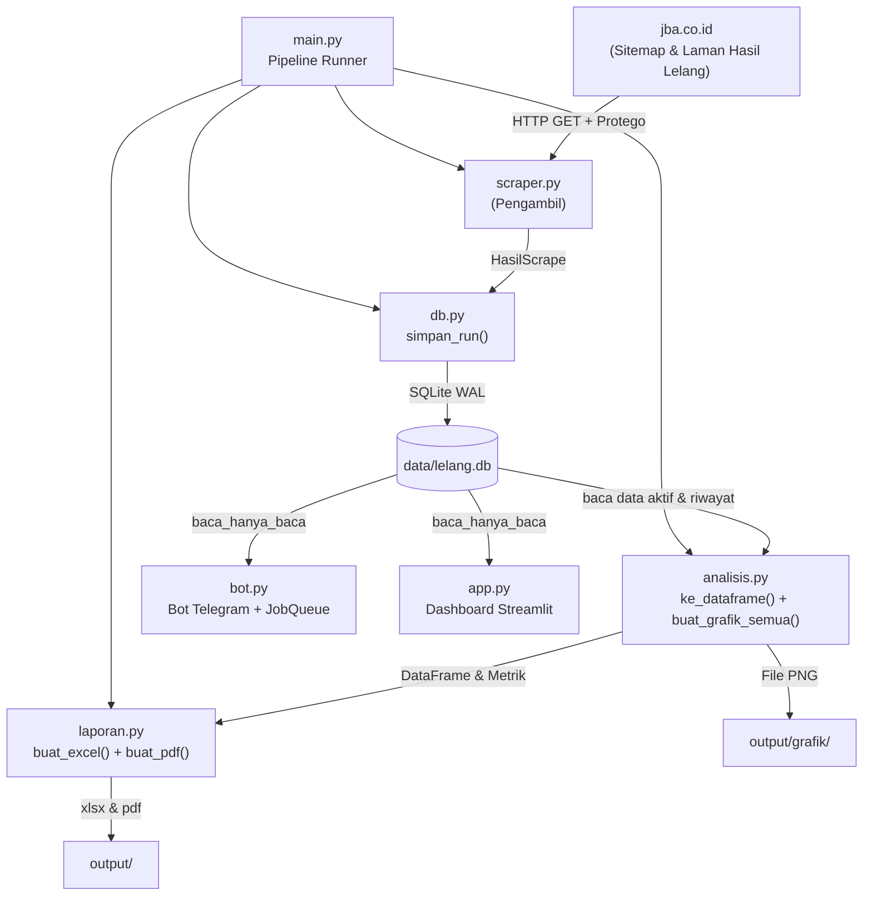

# Pantau Hasil Lelang JBA

Aplikasi pemantau **Hasil Harga Lelang Mobil Bekas** di JBA Indonesia (`jba.co.id`), dilengkapi pipeline web scraping otomatis, penyimpanan database SQLite incremental, bot Telegram interaktif dengan penjadwalan harian, laporan otomatis (Excel & PDF), dan dashboard web Streamlit.

Proyek ini dibangun untuk memenuhi tugas perkuliahan **Scripting Language UNY**.

---

## 1. Fitur Utama

- **Scraping Beretika & Otomatis**: Menelusuri sitemap hasil lelang mobil resmi, validasi robots.txt dengan parser wildcard (`protego`), jeda sopan minimal 1.5 detik per request, dan deteksi proteksi akses.
- **Penyimpanan Incremental & Deteksi Perubahan**: Menggunakan SQLite (mode WAL). Mengenali status data awal (*baseline*), baris baru (*baru*), penambahan unit identik (*tambah*), pengurangan unit (*kurang*), dan unit terjual/selesai (*hilang*). Dilengkapi penjaga anomali untuk melindungi data dari lonjakan/penurunan parsing yang tidak wajar.
- **Bot Telegram Terjadwal (`bot.py`)**: Asisten interaktif untuk cek ringkasan, pencarian model, statistik per lokasi, perubahan harga, hingga unduh grafik dan laporan. Otomatis mengirim ringkasan harian pukul 07:00 WIB via `JobQueue` dengan fitur *catch-up* jika komputer sempat mati.
- **Dashboard Web Streamlit (`app.py`)**: Dashboard visual interaktif mode baca-saja (*read-only*) dengan filter merek, model, rentang tahun, lokasi, dan harga, serta fitur unduh data terfilter ke format CSV.
- **Laporan Otomatis (`laporan.py`)**: Ekspor multi-sheet Excel (.xlsx) rapi dengan openpyxl serta dokumen ringkasan PDF (.pdf) dengan reportlab.

---

## 2. Arsitektur Sistem



---

## 3. Instalasi dan Persiapan

### Prasyarat
- Python 3.11 atau lebih baru
- Virtual environment (`venv`)

### Langkah Instalasi
```bash
# 1. Masuk ke folder proyek
cd "c:/Kuliah/Semestar 5/Scripting Languange/Praktik/Bot_Harian"

# 2. Buat dan aktifkan virtual environment (jika belum ada)
python -m venv env
# Di Windows:
.\env\Scripts\activate

# 3. Instal dependensi
pip install -r requirements.txt

# 4. Salin file template environment
copy .env.example .env
```

### Konfigurasi `.env`
Buka file `.env` dan sesuaikan nilainya:
```ini
# Token bot dari @BotFather di Telegram
BOT_TOKEN=123456789:ABCdefGhIJKlmNoPQRstuVWXyz

# Chat ID Telegram pemilik bot (opsional, untuk perintah /scrape)
OWNER_CHAT_ID=12345678

# Email kontak identitas User-Agent (WAJIB diisi demi etika scraping)
CONTACT_EMAIL=mahasiswa@student.uny.ac.id

# Jadwal harian bot (WIB)
JAM_JADWAL=07:00

# Kirim pesan harian meskipun tidak ada perubahan data (true/false)
KIRIM_JIKA_TIDAK_ADA_PERUBAHAN=true
```

---

## 4. Cara Menjalankan

### A. Menjalankan Pipeline Pengumpulan Data
```bash
# Uji coba cepat: hanya ambil 3 model awal
python main.py --maks-model 3

# Menjalankan scraping penuh seluruh model di sitemap
python main.py

# Memperbarui analisis dan laporan dari data yang sudah ada di database (tanpa scraping)
python main.py --tanpa-scrape
```

### B. Menjalankan Bot Telegram
Pastikan database sudah terisi minimal sekali (jalankan `main.py --maks-model 3`).
```bash
python bot.py
```
**Perintah di Telegram:**
- `/start` atau `/help` — Menampilkan bantuan perintah.
- `/ringkas` — Ringkasan metrik hasil lelang (total unit, harga rata-rata, median, rentang).
- `/model <nama>` — Statistik lengkap model tertentu (contoh: `/model avanza`).
- `/cari <kata>` — Mencari model mobil.
- `/lokasi <nama>` — Statistik lelang di kota/lokasi tertentu (contoh: `/lokasi jakarta`).
- `/baru` — Melihat daftar perubahan/unit lelang terbaru.
- `/grafik` — Mengirim gambar grafik analisis.
- `/laporan` — Mengirim file dokumen Excel dan PDF terbaru.
- `/status` — Informasi status run scrape terakhir & jadwal harian.
- `/langganan` & `/berhenti` — Mengatur langganan notifikasi harian otomatis.
- `/scrape` — Menjalankan scraping manual (khusus pemilik bot).

### C. Menjalankan Dashboard Streamlit
```bash
streamlit run app.py
```
Buka browser pada alamat `http://localhost:8501`.

### D. Menjalankan Skrip Demo Perubahan
Untuk keperluan simulasi presentasi tanpa menyentuh data asli:
```bash
python scripts/demo_perubahan.py
```

---

## 5. Penjadwalan Lokal dan Pesan Harian Bot

- Penjadwalan harian berjalan secara internal di dalam **`bot.py`** menggunakan modul `JobQueue` dari `python-telegram-bot`.
- **Syarat penjadwalan:** Komputer/laptop harus dalam keadaan menyala dan proses `python bot.py` harus tetap aktif.
- **Fitur Catch-up:** Jika laptop mati saat jam jadwal (misalnya pukul 07:00 WIB), saat bot dinyalakan kembali bot akan memeriksa stempel waktu run terakhir. Jika belum ada run dalam 24 jam terakhir, bot akan secara otomatis menjalankan proses *catch-up* setelah 30 detik.
- **Aturan Pesan Harian ke Pelanggan:**
  Setiap run terjadwal (termasuk run catch-up) mengirim pesan ke pelanggan terdaftar menurut hasil eksekusinya:
  - **Sukses, ada perubahan:** Mengirim ringkasan dan daftar perubahan (maksimal 10 item, sisanya dituliskan "dan N lainnya").
  - **Baseline (run pertama):** Penjelasan bahwa data ini adalah data acuan awal (bukan perubahan), beserta jumlah model dan baris yang tersimpan.
  - **Sukses, tanpa perubahan:**
    - Jika `KIRIM_JIKA_TIDAK_ADA_PERUBAHAN=true` (default): Bot mengirim pesan singkat berisi waktu selesai (WIB), jumlah model yang dicek, jumlah baris total, dan keterangan *"tidak ada hasil lelang baru atau perubahan"*.
    - Jika `KIRIM_JIKA_TIDAK_ADA_PERUBAHAN=false`: Bot tidak mengirim pesan ke pelanggan, namun run tetap tercatat di log dan dapat dilihat via `/status`.
  - **Sebagian (ada model gagal):** Selalu dikirim ke pelanggan dengan memuat jumlah model gagal serta ringkasan perubahan jika ada.
  - **Gagal atau dihentikan:** Selalu dikirim ke pelanggan dengan pesan singkat bahwa scraping hari ini gagal beserta tanggal data terakhir yang valid. Pemilik bot (`OWNER_CHAT_ID`) akan menerima detail error/penyebab kegagalan.
  - **Run dilewati:** Jika scraping lain sedang berjalan (`asyncio.Lock` terkunci), run dilewati dan tidak mengirim pesan apa pun.

---

## 6. Etika Scraping & Keterbatasan

### Kebijakan Etika Scraping (WAJIB)
1. **Robots.txt & Sitemap:** Aplikasi hanya mengambil URL sitemap `id-hasil-lelang-mobil.xml` dan halaman publik `/id/hasil-harga-lelang/lelang/<slug>` yang diizinkan oleh `robots.txt`. Setiap URL dicek terlebih dahulu menggunakan parser wildcard `protego`.
2. **URL Terlarang:** Aplikasi tidak pernah mengakses atau membentuk URL terlarang seperti laman pencarian (`/search...`), halaman detail lot berbayar (`/search-detail/...`), atau parameter paginasi (`?page=`).
3. **Jeda Sopan:** Setiap request diberi jeda minimal 1.5 detik dan berjalan secara sekuensial (tanpa multi-threading scraping).
4. **User-Agent:** Mengirimkan identitas User-Agent yang jelas dan mencantumkan alamat email kontak mahasiswa (`CONTACT_EMAIL`).
5. **Penanganan Hambatan:** Jika server merespon dengan kode 403, 429, atau laman tantangan CAPTCHA, proses scraping langsung dihentikan demi menghormati server target.
6. **Perlindungan Privasi:** Aplikasi hanya menyimpan data agregat (Merek, Model, Tahun, Lokasi, Harga). **Tidak ada nomor polisi, foto, atau data identitas apa pun yang disimpan.**
7. **Tujuan Edukasi:** Seluruh data merupakan milik PT JBA Indonesia dan digunakan murni untuk keperluan studi/tugas perkuliahan di Universitas Negeri Yogyakarta.

### Keterbatasan Sistem
- Laman hasil lelang JBA tidak menyediakan nomor identifikasi unik (*ID*) maupun tanggal pelaksanaan per baris data. Oleh karena itu, deteksi perubahan dilakukan melalui perbandingan tuple identik `(merek, model, tahun, lokasi, harga)`.
- Baris identik (misalnya model dan harga yang sama muncul beberapa kali dalam satu lokasi) dipertahankan jumlah kemunculannya dan tidak dideduplikasi.
- Struktur HTML situs eksternal dapat berubah sewaktu-waktu. Jika header kolom tidak sesuai, parser akan memunculkan exception `StrukturBerubah`.

---

## 7. Pengujian Otomatis

Proyek dilengkapi dengan 22 unit test terisolasi menggunakan `pytest`. Pengujian menggunakan fixture lokal tanpa memerlukan koneksi internet:
```bash
pytest
```

---

## 8. Struktur Folder

```
Bot_Harian/
├── config.py                 # Konfigurasi terpusat dan pembacaan .env
├── skema.py                  # DDL skema database SQLite
├── scraper.py                # Lapisan 1: Scraping dan parsing HTML
├── db.py                     # Lapisan 2: Transaksi SQLite & deteksi perubahan
├── analisis.py               # Lapisan 3: Olah data pandas & visualisasi matplotlib
├── laporan.py                # Lapisan 4a: Pembuatan file Excel & PDF
├── pesan.py                  # Format teks balasan HTML untuk bot
├── bot.py                    # Lapisan 4b: Bot Telegram & penjadwalan JobQueue
├── app.py                    # Lapisan 4c: Dashboard web Streamlit
├── main.py                   # Titik masuk eksekusi pipeline data
├── scripts/
│   └── demo_perubahan.py     # Simulasi deteksi perubahan (data uji)
├── tests/
│   ├── conftest.py           # Inisialisasi path tes
│   ├── fixtures/
│   │   ├── robots_jba.txt    # Salinan robots.txt JBA
│   │   ├── sitemap_hasil_mobil.xml # Contoh XML sitemap
│   │   ├── hasil_avanza_v1.html    # Fixture HTML asli
│   │   └── hasil_avanza_v2.html    # Fixture HTML sintetis untuk uji perubahan
│   ├── test_scraper.py
│   ├── test_db.py
│   ├── test_perubahan.py
│   ├── test_analisis.py
│   ├── test_pesan.py
│   └── test_laporan.py
├── data/                     # Database SQLite lelang.db (diabaikan git)
├── output/                   # File Excel, PDF, dan grafik (diabaikan git)
├── logs/                     # File log eksekusi pipeline (diabaikan git)
├── requirements.txt
├── .env.example
├── .gitignore
├── pytest.ini
└── README.md

